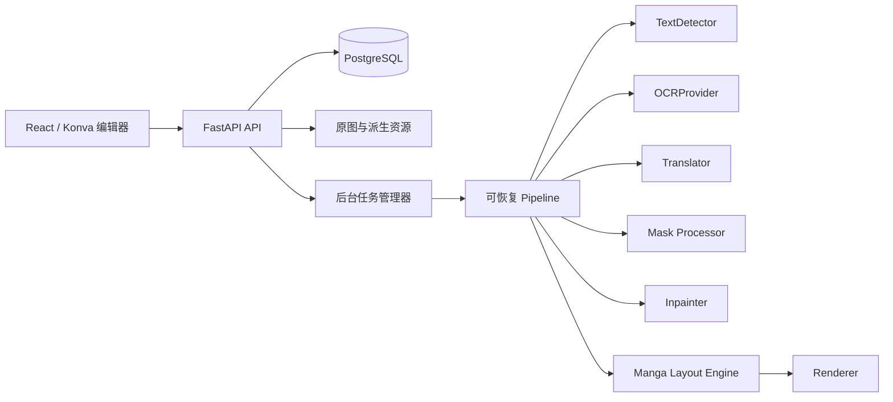

# MangaFlow

[](https://github.com/ALittlePandaMan/MangaFlow/actions/workflows/ci.yml)

当前版本：`v0.1.2`

MangaFlow 是一个面向日本漫画的非破坏式 AI 翻译与嵌字工作台。它把文字检测、OCR、上下文翻译、文字分割、背景修复、横/竖排版、人工精修和批量导出串成可恢复流水线。原图始终只读，Mask、净图、透明文字层和最终译图分别保存。

当前仓库提供完整可运行的本地工作流。Docker 镜像提供 RF-DETR 独立运行环境与 MangaOCR，默认用 RF-DETR 统一检测文字、气泡和分镜，用 MangaOCR 识别日文漫画。RF-DETR 权重需按[版面检测说明](docs/text-classification.md)显式安装；其他本地模型首次加载时下载所需权重。翻译在未配置 LLM 时只透传原文并标记复核，不会伪装成翻译结果。

> 当前版本定位为可信本机或受控局域网工具，没有用户登录和公网级权限隔离，请勿直接暴露到互联网。

Docker 默认只绑定 `127.0.0.1`。确需可信局域网访问时，可显式设置 `MANGAFLOW_BIND_HOST`，并配置防火墙和反向代理鉴权。`/media` 只允许漫画图片、历史图片和字体资产，数据库、配置和工程元数据不会通过静态资源地址公开。

编辑历史最多保留 100 步。单框属性、批量属性和蒙版修改只记录受影响区域；检测、导入、删除等结构性操作保留完整快照。后台每十分钟检查空闲项目，仅清理不再被当前页面、撤销/重做或区域修订引用的历史资产；新文件有十分钟保护期，每次最多清理 128 个文件，不删除原图。

[架构](docs/architecture.md) · [配置与迁移](docs/configuration.md) · [开发指南](docs/development.md) · [MCP 接入](docs/mcp.md) · [常见问题](docs/troubleshooting.md)

## 架构



后端业务只依赖抽象接口，模型选择集中在 `ProviderRegistry`。开发队列使用 `asyncio` 后台任务，包含队列、暂停、继续、失败重试、取消、进度和 WebSocket 更新；`ProcessingTask` 与 Pipeline 边界可直接替换为 Celery、RQ 或 Dramatiq worker，业务阶段无需改写。

## 已实现功能

- 漫画翻译 MCP：设置页默认开启，支持 Agent 自动导入、翻译去字、逐页看图纠错和导出；提供 HTTP 与本地 stdio 连接，管理配置继续在网页操作。
- Project、批量图片上传、页序、缩略图导航和非破坏式文件存储。
- 稳定 `TextRegion` ID，`R001` 等显示名称在删除或合并后连续编号；polygon、bbox、OCR、翻译、样式、Mask、锁定、复核原因和版面结果贯穿所有阶段。
- 页级和区域级 Detection / OCR / Translation / Inpainting / Rendering API；Pipeline 可从任意阶段继续。
- RF-DETR 统一输出文字、拟声词、气泡与分镜，按像素包含率关联文字和气泡，并按分镜 → 气泡 → 文字遍历阅读顺序；独立文字实例不强制合并。另有轻量 OpenCV 检测与 MangaOCR/PaddleOCR/Tesseract OCR 适配器。
- OpenAI-compatible 严格 JSON 翻译，支持 Ollama、vLLM、LM Studio 等兼容端点；检查 ID 遗漏/新增，自动重试。
- Polygon Mask、画笔/橡皮擦、硬度、撤销/重做、Clear/Dilate/Erode/Blur/Expand。
- 文本分割 Mask 只修改文字像素附近；背景修复统一交给 LaMa，并始终从不可变原图重建，避免整图色偏和重复处理污染。
- 漫画排版引擎：字形测量、逐字符换行、字号拟合、最小字号和 overflow；中文竖排按右到左列逐字布局，不旋转整段文字，并处理竖排标点和西文旋转。
- TrueType/OpenType、项目字体上传、按字符字体 fallback、颜色、描边、行距、字距、对齐、旋转与透明度。
- React/Konva 分层画布：缩放、平移、适屏、多选、拖动、四边形/多边形顶点、旋转、矩形/多边形/套索建区和区域合并。
- Original / Clean / Translated / Comparison 视图，右侧文本图层与可选 Mask 叠加，原文框与译文框独立几何，当前编辑会话 Undo/Redo。
- 最终译图、净图和可二次编辑的完整工程导出；未修复页面导出净图时自动回退原图。
- 云端 API Key 只写入被忽略的 `.env`，列表和响应只返回 `has_api_key`，日志不输出密钥。

## 目录

```text
.github/                    CI 和协作模板
backend/app/api/            FastAPI 路由
backend/app/application/    跨路由应用命令
backend/app/services/       Provider 与领域服务
backend/tests/              核心算法与 API 测试
frontend/src/components/    共享 UI
frontend/src/features/      编辑器等业务模块
frontend/src/pages/         路由页面
config.example.yaml         可公开提交的脱敏配置模板
config.yaml                 当前六项生效配置（不提交）
data/                       原图及派生资源（不提交）
models/                     本地模型缓存（不提交）
docker/                     后端、前端与 Nginx 镜像
docs/                       架构、配置与开发文档
scripts/                    初始化、开发和检查脚本
```

## 许可证

MangaFlow 使用 [MIT License](LICENSE)。

## 环境要求

- Python 3.11 或 3.12
- Node.js 20+
- PostgreSQL 18 与 psycopg 3（Docker 启动会自动创建数据库服务）
- 推荐安装 Noto Sans CJK 字体；Docker 镜像已包含
- OpenCV fallback 仅需 CPU。MangaOCR 或其他深度模型可使用 CUDA；具体 CUDA/PyTorch 版本应与显卡驱动匹配安装
- Docker 24+ 与 NVIDIA Container Toolkit（Docker GPU 推理）

## 本地安装与启动

本地开发需先准备可连接的 PostgreSQL，设置 `MANGAFLOW_DATABASE_URL` 和进程环境中的 `PGPASSWORD`，详见[数据库配置](docs/configuration.md#postgresql-数据库)。默认 Compose 数据库仅供容器内部连接，不发布宿主机端口；完整容器运行可直接使用下文的 Docker 启动方式。

```bash
./scripts/bootstrap.sh
./scripts/dev.sh
```

打开 `http://localhost:5173`；API 文档位于 `http://localhost:8000/docs`。也可以分别运行：

```bash
cd backend && ../.venv/bin/uvicorn app.main:app --reload --port 8000
cd frontend && npm run dev
```

## Docker

```bash
./scripts/docker.sh up --build
```

该脚本在 WSL + Docker Desktop 环境中会自动调用 Windows Docker 客户端，确保 `data` 和 `models` 真正挂载到项目目录；在原生 Linux/macOS 中则直接调用 `docker compose`。后续的 Compose 命令也建议通过该脚本执行，例如 `./scripts/docker.sh ps`。

打开 `http://localhost:8080`。`data/` 与 `models/` 以卷挂载，因此重建容器不会丢失工程或已下载的权重；`config.yaml` 与 `.env` 会挂载到容器并在设置保存时同步更新。首次启动缺少本地配置时，`scripts/docker.sh` 会从脱敏的 `config.example.yaml` 与 `.env.example` 自动创建。

## 模型配置

“设置 → 性能与并发”可选择自动调节、固定上限或串行。默认自动模式最多处理 4 个不同页面，CPU 蒙版计算最多使用 4 个工作线程；实际放行数量根据内存余量、CPU 负载和处理耗时调整。同一页的任务保持有序，本地共享模型推理暂时统一限制为 1 路，云端请求遵守 Provider 限流。减少上限不会中断正在执行的任务。设置保存在 `data/execution-policy.json`，重启后保留。

页面任务池与 CPU 计算池互相独立，子线程只计算蒙版、返回普通数据；页面任务负责数据库与撤销记录。模型加载、推理和异常回退共用保护锁；图片写入采用临时文件原子替换。PostgreSQL 使用短事务与行锁，项目历史提交保持有序。自动调节属于保守试探，并发增加不保证每一种任务都更快。

开发环境需安装 `backend/requirements/dev.txt`；生产环境的基础及性能监测依赖统一在 `base.txt`。使用 `bash scripts/test-backend.sh -q` 在独立 PostgreSQL 数据库运行回归；不会调用真实云端 Provider。

当前可迁移配置位于 `config.yaml`，里面保存文字检测、图像修复、OCR、排版、云端翻译与字体六项活动配置，不包含数据库 ID、运行数据或任何 API Key。在设置页面安装、切换或编辑 Provider 后，后端会自动把当前生效配置原子写回该文件。Docker 后端每次启动都会幂等读取它：已有网页配置保持不变，只补齐缺失阶段；废弃的 Paddle 文字检测配置会迁移为 RF-DETR，现有页面不自动重检。配置中启用 `preload` 后会加载本地模型；MangaOCR、PaddleOCR 识字与 LaMa 可以自动下载，RF-DETR 权重需先显式安装。

云端翻译的地址、协议、模型和 Prompt 会写入 `config.yaml`，密钥只写入被 Git 忽略的 `.env`，不会进入 YAML 或 API 响应。`config.example.yaml` 和 `.env.example` 只包含 `example.com`、`example-model` 与空密钥。迁移到另一台电脑时，安全复制源码、`config.yaml`、`.env` 与需要保留的 `data/`，然后执行：

```bash
./scripts/docker.sh up --build -d
```

`models/` 为空时需重新安装 RF-DETR 权重，其他模型按需自动下载；复制原有 `models/` 可直接复用缓存。Compose 健康检查会让前端等待后端完成首次模型准备，避免下载期间过早进入工作台。

首次运行某阶段且没有默认配置时，后端仍会自动登记推荐配置。也可以在“设置”页面点击“安装推荐配置”，完成配置升级及加载验证（RF-DETR 权重需预先安装）；CLI 等价命令为：

```bash
./scripts/docker.sh exec backend python -m app.services.infra.model_provisioning --preload --upgrade-fallbacks
```

推荐组合与可替换 Provider：

- Detection：推荐 `rfdetr`（Koharu RF-DETR），一套模型检测文字、拟声词、气泡和分镜；保留 `opencv-fallback` 作为低资源选项。旧 Paddle 检测与 YOLO 气泡链路已移除，PaddleOCR 识字适配器不受影响。
- OCR：默认 `manga-ocr`；也可选择 `review-fallback`、`tesseract`、`paddleocr`、`cloud-ocr`（专用云端 OCR 通用接口）或 `cloud-multimodal`（多模态大模型识字）。首次加载 MangaOCR 会下载约 400 MB 权重。
- Translation：`openai-compatible`。填写 Base URL、模型名和 API Key；Ollama 示例地址为 `http://localhost:11434/v1`。
- Inpainting：Docker 镜像内置 `simple-lama-inpainting`，推荐配置统一使用 `lama` 处理文字区域；`opencv` 仅作为低资源备选。
- Rendering：`pillow`，支持系统 `.ttf` / `.otf` / `.ttc` / `.otc` 字体集合和项目上传字体；低对比文字会自动补反色描边。

版面检测权重来自 [`mayocream/koharu-layout-rfdetr-seg-2xl-1152`](https://huggingface.co/mayocream/koharu-layout-rfdetr-seg-2xl-1152)，固定 revision 并校验 SHA-256，不随仓库提交。模型涉及 Manga109 衍生训练数据，不应假设代码授权同时覆盖权重和训练数据；商业使用前请核对各自条款。详见[版面检测说明](docs/text-classification.md)。

Docker 默认把 NVIDIA GPU 注入后端，并使用 CUDA 12.6 版 PyTorch/PaddlePaddle。可迁移清单的 `device: recommended` 只在缺失配置首次导入时检测硬件，并在数据库中落成明确的 `cuda:0` 或 `cpu`，Provider 运行期间不使用 `auto`。可用 `.env` 中的 `MANGAFLOW_GPU_DEVICE` 指定 GPU index/UUID，默认为 `all`。

非 Docker 开发环境如只需 CPU，可先安装 PyTorch CPU 版，再安装模型依赖：

```bash
pip install --index-url https://download.pytorch.org/whl/cpu torch==2.6.0
pip install --extra-index-url https://www.paddlepaddle.org.cn/packages/stable/cpu/ -r backend/requirements/models.txt
```

Paddle Provider 会自动将保存的 `cuda:0` 转换为 Paddle 使用的 `gpu:0`。

## 环境变量

### 可选：多模态大模型识字

在“设置 → OCR 识别 → 编辑”中，将 Provider 切换为“多模态大模型识字”。可以选择“使用当前翻译模型”，保存时由后端复制默认翻译模型的地址、协议、模型名和密钥；不会把密钥返回浏览器，也不会复制翻译 Prompt。复制后 OCR 与翻译配置独立，后续改动不自动同步。也可以独立填写 API Base URL、API Key，获取并选择模型；服务商没有模型列表时，可以手动输入完整模型 ID。所选模型必须支持图片输入。

支持 OpenAI Chat Completions、OpenAI Responses 和 Anthropic Messages 兼容协议；图片请求格式分别参考 [OpenAI 图片输入](https://developers.openai.com/api/docs/guides/images-vision)与 [Anthropic Vision](https://platform.claude.com/docs/en/build-with-claude/vision)。完整端点 URL 可以自动判断协议，也可以手动指定；Base URL 通常需要包含服务商要求的 `/v1` 前缀。

识别 Prompt、超时、失败重试和最大输出 Token 数都可配置，Temperature 可以留空使用模型默认值。系统会自动附加 `{"text":"原文"}` 输出约定。拒绝、截断或格式错误不会作为原文写入；识别结果没有可用置信度时，不伪造分数。

此模式仍使用本地文字检测和气泡关联结果，逐框上传裁剪图片（最长边最多 2048 px）并将识别结果写入原文，不直接翻译或重新划分气泡。**图片会发送给配置的服务商，并可能按区域请求产生费用。** 保存配置和启动检查不会上传图片；点击 OCR 后才会请求识别。OCR 与翻译的密钥独立，OCR 使用 `.env` 中的 `MANGAFLOW_OCR_API_KEY`，不会把密钥写入 `config.yaml`。安装此功能不会自动切换现有本地 OCR。

### 可选：云端 OCR（通用接口）

此入口用于专用 OCR 服务，和上面的通用多模态大模型分开配置，但都只上传裁剪区域。切换 Provider 时会保留各自已保存的配置和密钥；保存后所选 Provider 成为当前 OCR，原有本地 OCR 配置也保留。

- **OCR 专用模型（Chat Completions）**：填完整识别地址（例如 `https://api.siliconflow.cn/v1/chat/completions`）、独立密钥和 OCR 模型名。通过标准 `image_url` 消息传入 PNG Data URL，使用 `max_tokens`，直接读取 `choices[0].message.content` 的纯文字，不要求模型输出 JSON。截断或拒绝不会写入原文。
- **JSON + Base64**：自定义图片字段名、纯 Base64 / Data URL 编码、非敏感附加参数和返回文字路径。
- **Multipart 文件上传**：自定义上传字段名和标量附加参数。图片文件名固定为 `region.png`。
- **鉴权与返回值**：支持 Bearer Token、自定义 API Key 请求头或无鉴权；`data.words.*.text` 可提取多个文本字段并按返回顺序换行，`result.0.text` 支持数组下标。密钥不能放入 URL 或附加参数；不会跟随重定向。

硅基流动的调用格式见[官方 Chat Completions 文档](https://api-docs.siliconflow.cn/docs/api/chat-completions-post)。`PaddlePaddle/PaddleOCR-VL-1.5` 的识别指令为 `OCR:`，见[官方模型卡](https://huggingface.co/PaddlePaddle/PaddleOCR-VL-1.5)。`deepseek-ai/DeepSeek-OCR` 的纯文本识别指令为 `<image>`、换行、`Free OCR.`，见[官方多模态输入文档](https://docs.siliconflow.cn/docs/userguide/capabilities/multimodal-vision)。具体模型可用性以服务端模型列表为准。

“通用接口”并不意味着自动兼容所有厂商。需要签名算法、OAuth、查询参数鉴权、异步任务轮询或专有二进制协议的服务，需新增适配器或在前面提供兼容网关。专用 OCR 模型也可能采用视觉语言架构；这里按用途和输出协议区分，而不是按 HTTP 端点名称区分。

### 云端 OCR 并发调度

两种云端识别均可在配置窗口选择串行、固定或自适应并发。已有云端配置未设置这些字段时，默认使用自适应：从 2 路开始（不超过设定上限），默认上限 8，允许设置 1–16；每分钟最多发起 60 次请求，可按服务商配额调整为 1–6000。每个区域仍是独立请求，不额外上传图片探测上限。

- 连续成功后逐步增加；增加并发未提高估算吞吐时回退。HTTP 429、超时或服务端错误会降低自适应并发并统一退避，优先遵守 `Retry-After`。固定模式保持设定数量，但仍遵守速率和退避。
- 失败区域按“失败重试”次数重试，成功结果不重复请求；401/403 等不可重试错误停止后续派发。进度显示完成数、当前在途/允许并发数及退避倒计时。
- 同一个后端进程内，相同接口域名/端口、密钥及模型的 OCR 和翻译共享速率、并发额度与退避。翻译仍将一页待翻译文本合成一次请求。不同密钥的账号总额度、TPM/图片额度不能由此推断，应按服务商限制设置；多进程部署需外部共享限流器。
- 暂停或取消后不再派发新请求，等待已发请求结束后释放任务；已发送请求仍可能计费，取消后返回的文字不会写入。每个结果由主任务统一写库，并检查区域版本，手工修改、锁定或删除后不会被旧结果覆盖。
- 本地 OCR 保持串行，页面队列并发配置不变。学习值只保留在进程内，空闲 10 分钟重新从低并发开始，重启后重新学习。

### 通用配置

所有变量以 `MANGAFLOW_` 开头。常用变量见 `.env.example`：数据目录、模型目录、模型清单路径、云端翻译 API Key、自动配置开关、数据库 URL、CORS、上传大小、OCR 复核阈值、队列并发数与 Fernet 密钥。不要把真实 `.env` 或密钥提交到版本库。

## 完整操作流程

1. 新建项目并批量导入漫画原图。
2. 打开编辑器，使用“重新检测”完成整页检测和 OCR；也可用“批量识别”处理其他尚未识别的页面。检查文本框后再执行翻译或修复；已有框但原文为空时，翻译会先补 OCR。
3. 检查检测框；可拖动/缩放/旋转，编辑 polygon 顶点，或用矩形、多边形、套索补建区域。
4. 在右侧编辑 OCR 原文、方向和几何；右键单一区域可重新 OCR、修复或翻译。再次“重新检测”会替换该页现有框和识别结果，不跳过已编辑的框。
5. 配置 OpenAI-compatible Provider 后按页翻译；锁定人工确认区域可避免批处理覆盖。
6. 切换蒙版视图，用画笔添加、橡皮擦删除 Mask，形状笔刷也遵守当前添加/删除模式，然后执行修复。检测设置的四边扩边仅调整文本框，不膨胀修复 Mask。
7. 编辑译文、字体、字号、行字距、颜色、描边、对齐和旋转，检查画布预览与 overflow warning。翻译、修复后会自动排版，导出时按当前文字与样式渲染。
8. 导出译图、净图或完整工程 ZIP；工程包可再次导入继续编辑。

## 测试

文字像素分割、气泡保护、残留复核、分镜阅读顺序及可见文本框排版的原理、模型安装和限制见 [翻译质量说明](docs/translation-quality.md)。

```bash
./scripts/check.sh
```

测试覆盖日漫阅读顺序、Mask 后处理、结构化翻译 ID、横竖排 font fitting、overflow、项目/页面/区域 API、密钥脱敏，以及前端全局 Dialog 和加载状态的用户交互与无障碍语义。

## 常见问题

- **找不到中文字形**：安装 Noto Sans CJK，或在项目字体接口/界面上传包含目标字符的 TTF/OTF。
- **MangaOCR 首次很慢**：首次会下载和加载权重；确认缓存目录可写，GPU 环境确认 PyTorch 能识别 CUDA。
- **OpenAI-compatible 返回解析错误**：确认服务支持 chat completions，并让模型只返回以 `R001` 等 ID 为键的 JSON 对象。
- **修复破坏气泡边框**：在蒙版视图用橡皮擦缩小擦除范围。Inpainting 是依据上下文生成合理背景，不是恢复已不可见的真实像素。
- **数据库连接或锁冲突**：默认使用 PostgreSQL，先检查数据库健康状态与连接配置，再排查长事务或额外写入进程。配置和备份见[数据库配置](docs/configuration.md)。任务调度仍只支持一个后端服务进程，不能因换库增加 workers。
